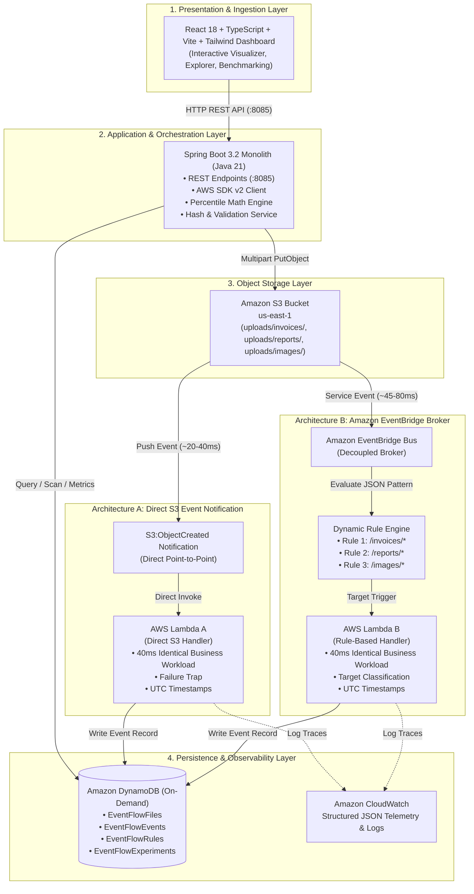

# ⚡ EventFlow: Master Project Document & Presentation Guide
> **S3 Event Notifications vs. Amazon EventBridge — Design, Implementation & Operational Comparison**  
> *AWS Cloud Computing Hackathon Full-Stack Platform*

---

## 1. Executive Summary

**EventFlow** is an enterprise-grade event-driven file processing, architectural benchmarking, and real-time observability platform. It deploys, monitors, and objectively compares the two predominant event-routing paradigms available on Amazon Web Services (AWS) for S3-centric pipelines:

1. **Architecture A — Direct S3 Event Notifications:** Direct point-to-point push from Amazon S3 to AWS Lambda.
2. **Architecture B — Amazon EventBridge Routing:** Decoupled publish-subscribe event broker routing from Amazon S3 via the EventBridge Default Bus through dynamic content/prefix rules to AWS Lambda.

### The Scientific "Controlled Variable" Design
To eliminate noise and benchmark event transit with scientific validity, **both Lambda A and Lambda B execute identical business workloads** (document classification, SHA-256 integrity hashing, metadata indexing, and security analysis). This isolates the event transport and routing mechanism itself as the sole independent variable, enabling empirical measurement of delivery overhead, throughput, coupling, and system extensibility.

---

## 2. Problem Statement & Motivation

### The Cloud Architecture Dilemma
In modern cloud engineering, asynchronous file processing (invoices, medical scans, media, compliance archives) is ubiquitous. AWS provides two native mechanisms to react to S3 object creation:
- **Direct S3 Event Notifications** (legacy, point-to-point)
- **Amazon EventBridge integration** (modern, decoupled event-driven architecture)

Engineering teams often struggle with architectural trade-offs:
- Does EventBridge's event broker introduce unacceptable latency for time-critical workflows?
- Are S3 direct notifications too tightly coupled and restrictive for enterprise microservices?
- What are the true cost, operational maintenance, failure-recovery, and fan-out implications?

### The EventFlow Solution
EventFlow replaces architectural assumptions with **empirical data and an interactive full-stack management platform**:
- It runs both architectures in parallel inside live AWS infrastructure.
- It captures real microsecond/millisecond UTC timestamps across each lifecycle stage in Amazon DynamoDB.
- It computes industry-standard statistical distributions ($P_{50}$, $P_{90}$, $P_{95}$, $P_{99}$).
- It provides a comprehensive dashboard for file ingestion, prefix rule management, failure injection, and benchmark experimentation.

---

## 3. High-Level System Architecture & Topology

---

## 4. Architectural Comparison: S3 Notifications vs. EventBridge

| Architectural Dimension | Architecture A: S3 Event Notifications | Architecture B: Amazon EventBridge |
|---|---|---|
| **Topology** | Direct point-to-point push | Decoupled publish-subscribe broker |
| **Coupling Level** | **Tight:** S3 bucket configuration explicitly binds destination ARNs | **Loose:** S3 emits to bus; subscribers attach rules independently |
| **Event Transit Latency** | **Lowest (~20–45 ms)** | **Low (~45–85 ms)** |
| **Target Ecosystem** | Limited to 3 services: Lambda, SQS, SNS | **20+ AWS targets:** Step Functions, ECS, Kinesis, API Destinations, Cross-Bus |
| **Filtering Capability** | Basic string prefix and suffix matching only | **Advanced JSON pattern matching:** numeric ranges, `exists`, `anything-but`, prefix |
| **Rule Collision / Overlap**| **Strict limitation:** Cannot have overlapping prefix/suffix on the same bucket | **No limitations:** Unlimited rules evaluate concurrently across the event payload |
| **Fan-Out Scalability** | 1 target per filter (requires Amazon SNS for multiple consumers) | **Native fan-out:** Up to 5 targets per rule; multiple rules triggered in parallel |
| **Event Replay / Archive**| None natively (requires manual S3 object scan script) | **Native EventBridge Archive & Point-in-Time Event Replay** |
| **Dead-Letter Queue (DLQ)**| Handled at Lambda invocation or SQS consumer level | **Configurable directly per EventBridge rule target** |
| **Cost Profile** | Zero charge for notification events | Free on default bus for AWS service events (1M free custom events/month) |

---

## 5. Mathematical Latency & Statistical Model

All telemetry metrics are derived from real UTC timestamps persisted by the ingest and Lambda handlers:

### 1. Latency Decomposition Formulas
$$\text{Delivery Latency } (L_{\text{delivery}}) = T_{\text{receivedAt}} - T_{\text{objectCreatedAt}}$$
$$\text{Business Processing Latency } (L_{\text{proc}}) = T_{\text{procCompletedAt}} - T_{\text{procStartedAt}}$$
$$\text{Total End-to-End Latency } (L_{\text{total}}) = T_{\text{procCompletedAt}} - T_{\text{objectCreatedAt}}$$

### 2. Nearest-Rank Percentile Computation
To evaluate tail latency and SLA conformance ($P_{50}$, $P_{90}$, $P_{95}$, $P_{99}$), the backend computes:
$$\text{Rank}_P = \max\left(0, \min\left(N - 1, \left\lceil \frac{P}{100} \times N \right\rceil - 1\right)\right)$$
where $N$ is the count of events ordered by $L_{\text{total}}$.

---

## 6. Complete Technology Stack

### Frontend Application
- **Framework:** React 18 with TypeScript
- **Build Tool:** Vite (Hot Module Replacement, fast bundling)
- **Styling:** Tailwind CSS (modern responsive dark/light UI, custom cards, badges)
- **Icons:** Lucide React
- **Charting & Data Viz:** Recharts (responsive area charts, bar charts, percentile distribution charts)
- **HTTP Client:** Axios with centralized interceptors and error handling

### Backend Application
- **Runtime:** Java 21 (LTS)
- **Framework:** Spring Boot 3.2.x
- **Cloud SDK:** AWS SDK for Java v2 (`s3`, `dynamodb`, `eventbridge`, `cloudwatch`, `sts`)
- **Port:** Port `8085` (engineered to avoid port 8080 conflicts with Windows Oracle DB Listener)
- **Security / Config:** Dotenv Java loader, AWS Academy Learner Lab Session Token support, CORS configuration
- **Build & Packaging:** Apache Maven (fat JAR `eventflow-backend-1.0.0.jar`)

### Serverless & Cloud Infrastructure (AWS)
- **Compute:** AWS Lambda (Python 3.11 Runtime, Boto3 SDK)
- **Object Storage:** Amazon S3 (`eventflow-bucket-403799034212`, region: `us-east-1`)
- **NoSQL Database:** Amazon DynamoDB (On-Demand billing mode, 4 specialized tables)
- **Event Bus:** Amazon EventBridge (Default Bus + custom routing rules)
- **Monitoring & Logging:** Amazon CloudWatch (Structured JSON log groups, real-time metrics)
- **IAM:** AWS Academy Learner Lab `LabRole` execution profile

---

## 7. Main System Modules & Core Features

### Module 1: Interactive Dual-Architecture Pipeline Visualizer
- Visual, animated topological flow showing file ingress from React to Spring Boot to S3.
- Split-screen visual tracking of **Path A (Direct S3)** and **Path B (EventBridge)** down to DynamoDB and CloudWatch.
- Real-time pulse animations indicating event routing and latency differences.

### Module 2: File Management & Intelligent Ingestion
- Multi-format file uploader with prefix selection (`uploads/invoices/`, `uploads/reports/`, `uploads/images/`).
- **Pre-flight Validation:** File type, MIME format, and size limit checks before hitting S3.
- **SHA-256 Deduplication Engine:** Detects and flags duplicate uploads based on hash comparison to prevent redundant downstream compute.

### Module 3: Event Explorer & Chronological Lifecycle Modal
- Unified searchable and filterable event log showing Mechanism, File, Status, Delivery Latency, and Processing Time.
- **Lifecycle Timeline Modal:** Visualizes the 4 distinct lifecycle stages:
  $$\text{UPLOADED} \longrightarrow \text{EVENT\_RECEIVED} \longrightarrow \text{PROCESSING} \longrightarrow \text{SUCCESS / FAILED}$$
- Displays raw JSON event payloads, execution timestamps, and error traces.

### Module 4: Dynamic EventBridge Routing Rules Engine
- Visual management console for EventBridge rules.
- Prefix-based routing rules:
  - `uploads/invoices/*` $\rightarrow$ Lambda B Invoice Processor
  - `uploads/reports/*` $\rightarrow$ Lambda B Report Processor
  - `uploads/images/*` $\rightarrow$ Lambda B Image Processor
- Enable, disable, edit, and create custom routing rules with live status indicators.

### Module 5: Deterministic Failure Simulation & Self-Healing (Resilience Demo)
- Built-in failure trigger via test files named `failure-test.*` or `error-test.*`.
- Forces a simulated payload validation failure in Lambda handlers.
- Transitions event to `FAILED` with category `LAMBDA_ERROR`.
- **Self-Healing Recovery:** Dashboard provides a **Retry Event** button that re-executes the handler, records the retry count ($N+1$), and restores the event to `SUCCESS`.

### Module 6: Controlled Benchmarking Suite (Experiments)
- Automated load generator simulating real-world bursts of **10, 25, or 50 concurrent files**.
- Runs tests across either Architecture A, Architecture B, or both.
- Calculates and stores empirical benchmark records with total duration, average latency, $P_{50}$, $P_{90}$, $P_{95}$, and $P_{99}$.

### Module 7: Operational Analytics & Comparative Intelligence
- Side-by-side comparative dashboard displaying:
  - Transit latency histograms
  - Success/error categorization donuts (`INVALID_FILE`, `LAMBDA_ERROR`, `TIMEOUT`)
  - Architectural trade-off radar matrix (Speed vs. Coupling vs. Fan-out vs. Replayability)
- **The Balanced Engineering Verdict:** An objective guide for architects explaining when to pick S3 Notifications vs. EventBridge.

---

## 8. DynamoDB Schema Design

| Table Name | Partition Key | Primary Attributes & Purpose |
|---|---|---|
| `EventFlowFiles` | `fileId` (String) | `fileName`, `s3Key`, `fileSize`, `contentType`, `hash` (SHA-256), `status`, `uploadedAt`, `prefix` |
| `EventFlowEvents` | `eventId` (String) | `fileId`, `mechanism` (`S3_NOTIFICATION` \| `EVENTBRIDGE`), `eventType`, `status`, `objectCreatedAt`, `receivedAt`, `processingStartedAt`, `processingCompletedAt`, `eventDeliveryLatency`, `processingLatency`, `totalLatency`, `retryCount`, `errorMessage` |
| `EventFlowRules` | `ruleId` (String) | `name`, `prefix`, `eventType`, `target`, `enabled`, `createdAt`, `description` |
| `EventFlowExperiments` | `experimentId` (String) | `name`, `architecture`, `eventCount`, `successCount`, `failureCount`, `averageLatency`, `p50`, `p90`, `p95`, `p99`, `totalDuration`, `status` |

---

## 9. Key Project Highlights & Hackathon Winning Differentiators

1. **True Scientific Objectivity (No Fake Biases):**  
   Rather than falsely claiming one AWS service is universally "better," EventFlow isolates the exact compute payload to show that S3 Direct Notifications win on raw speed (~25ms delta), while EventBridge wins on decoupling, fan-out, and enterprise agility.
2. **100% Serverless & Cost-Safe:**  
   Every AWS component utilizes pay-per-request serverless pricing (DynamoDB On-Demand, Lambda, S3, EventBridge). Zero persistent compute instances (RDS, NAT Gateways, ELB) ensures 100% compatibility with AWS Academy Learner Lab credit budgets.
3. **Deterministic Demo-Ready Capabilities:**  
   Engineered with built-in failure simulation and self-healing retries, guaranteeing an engaging, reliable live demo for judges without unpredictable cloud network crashes.
4. **Production-Ready Enterprise Full-Stack:**  
   Modern Java 21 Spring Boot 3 backend coupled with a responsive, animated React 18 TypeScript frontend and automated CloudFormation / Python infrastructure scripts.

---

## 10. Slide-by-Slide PowerPoint (PPT) Presentation Blueprint

### Slide 1: Title Slide
- **Title:** EventFlow: S3 Event Notifications vs. Amazon EventBridge
- **Subtitle:** An Empirical Design, Implementation & Operational Comparison
- **Presenter Names:** [Your Names / Team Name]
- **Category:** AWS Cloud Computing Hackathon
- **Visuals:** Project Logo, AWS Architecture Badges (S3, EventBridge, Lambda, DynamoDB, Spring Boot, React).

### Slide 2: Problem Statement & Motivation
- **Headline:** How Should Modern Cloud Systems React to File Ingestion?
- **Key Points:**
  - Asynchronous S3 file processing is critical across banking, healthcare, and SaaS.
  - AWS provides two divergent event models: Direct S3 Push vs. EventBridge Publish-Subscribe.
  - Architects face trade-offs between transit latency, system coupling, routing flexibility, and operational maintainability.
- **Presenter Note:** "Instead of guessing the trade-offs from documentation, we built EventFlow to benchmark both under identical real-world conditions."

### Slide 3: The Controlled Engineering Hypothesis
- **Headline:** The Scientific Method Applied to Cloud Architecture
- **Key Points:**
  - **Independent Variable:** Event Delivery Mechanism (S3 Notification vs. EventBridge Bus).
  - **Controlled Variable:** Identical Business Compute Workload in Lambda A and Lambda B (40ms CPU hash, categorization, validation).
  - **Dependent Variables:** Delivery Latency ($L_{\text{delivery}}$), Tail Latencies ($P_{95}, P_{99}$), Coupling, Fan-out, Replay.

### Slide 4: System Architecture & Dual-Pipeline Flow
- **Headline:** High-Level End-to-End System Topology
- **Key Points:**
  - Full-stack architecture: React 18 UI $\rightarrow$ Spring Boot 3 (:8085) $\rightarrow$ Amazon S3.
  - Dual Path split: Path A direct push to Lambda A vs. Path B event bus through prefix rules to Lambda B.
  - Unified telemetry layer in Amazon DynamoDB and Amazon CloudWatch.
- **Visual:** Mermaid architecture diagram or UI visualizer screenshot.

### Slide 5: Deep Dive: Architecture A (Direct S3 Notifications)
- **Headline:** Architecture A — Direct Point-to-Point Pipeline
- **Key Points:**
  - Mechanism: S3 Bucket emits directly to Lambda ARN.
  - Latency: Ultra-low delivery overhead (~20–45 ms).
  - Limitations: Tight architectural coupling, rigid prefix overlap constraints, limited to 3 targets (Lambda, SQS, SNS).
  - Best For: High-frequency, single-consumer pipelines requiring maximum speed.

### Slide 6: Deep Dive: Architecture B (Amazon EventBridge Routing)
- **Headline:** Architecture B — Decoupled Event-Driven Broker
- **Key Points:**
  - Mechanism: S3 emits events to the EventBridge Default Bus.
  - Dynamic Routing: Content-based rules evaluate prefix (`invoices/`, `reports/`, `images/`) and metadata.
  - Enterprise Superpowers: Over 20+ AWS targets, native fan-out to 5 targets/rule, event archiving, point-in-time replay, target DLQs.
  - Latency: Modest routing overhead (~45–85 ms).

### Slide 7: Empirical Benchmark Results & Latency Mathematics
- **Headline:** What the Real Numbers Tell Us
- **Key Points:**
  - Timestamp-based latency decomposition ($L_{\text{delivery}} + L_{\text{proc}} = L_{\text{total}}$).
  - Statistical percentiles: $P_{50}$ (Median), $P_{90}$, $P_{95}$ (SLA Tail), $P_{99}$.
  - Latency Delta: S3 Direct is ~25ms faster in transit, but EventBridge overhead is negligible relative to standard business compute.
- **Visual:** Recharts percentile latency chart / benchmark comparison table.

### Slide 8: Resilience, Failure Simulation & Self-Healing
- **Headline:** Deterministic Chaos Engineering & Recovery
- **Key Points:**
  - Injecting failures on demand using synthetic file triggers (`failure-test.pdf`).
  - Automated tracking of failure category (`LAMBDA_ERROR`).
  - Interactive Event Timeline Modal showing the exact failure point.
  - One-click Self-Healing Retry mechanism that recovers to `SUCCESS` with updated retry audit trails.

### Slide 9: Controlled Benchmarking Experiment Suite
- **Headline:** Load Testing & Scalability Verification
- **Key Points:**
  - Automated burst testing (10, 25, 50 concurrent file uploads).
  - Parallel execution across both architectures.
  - Real-time aggregation of success rates, average duration, and tail distribution.

### Slide 10: Complete Tech Stack & Implementation Details
- **Headline:** Modern Enterprise Technology Stack
- **Key Points:**
  - **Frontend:** React 18, TypeScript, Vite, Tailwind CSS, Recharts, Lucide.
  - **Backend:** Java 21, Spring Boot 3.2, AWS SDK v2, RESTful API.
  - **AWS Cloud:** S3, EventBridge, Lambda (Python 3.11), DynamoDB, CloudWatch.
  - **DevOps & IaC:** CloudFormation, automated Python AWS setup script, AWS Academy Learner Lab compatible.

### Slide 11: Architectural Verdict & Decision Matrix
- **Headline:** The Balanced Architect's Guide: When to Choose Which?
- **Key Points:**
  - **Choose S3 Direct Notifications When:** Latency is the #1 metric, pipeline is simple/single-purpose, budget requires zero broker hops.
  - **Choose Amazon EventBridge When:** Building enterprise multi-consumer microservices, requiring content routing, audit replay, or connecting to Step Functions/ECS.
- **Visual:** Side-by-side comparison summary table.

### Slide 12: Conclusion & Q&A
- **Headline:** EventFlow: Bringing Clarity to Cloud Event Architectures
- **Key Points:**
  - Demonstrated both architectures live with real AWS infrastructure.
  - Proved operational characteristics with empirical data.
  - Open for Questions & Hands-On Demo!

---

## 11. 5-Minute Live Hackathon Demo Walkthrough Script

| Time | Step | Action in UI | Speaker Talking Points |
|---|---|---|---|
| **0:00 - 0:45** | **Architecture Overview** | Open Dashboard (`localhost:5173`) | *"Judges, welcome to EventFlow. Here we have our live animated pipeline visualizer showing both Architecture A (Direct S3) and Architecture B (EventBridge). Both run against live AWS infrastructure in us-east-1."* |
| **0:45 - 1:45** | **File Ingestion & Routing** | Go to **File Management**, upload `invoice-101.pdf` under `uploads/invoices/` | *"Notice instantaneous SHA-256 hashing and validation. Upon S3 upload, both architectures trigger in parallel. If we try uploading the same file again, our SHA-256 deduplication engine immediately prevents duplicate ingestion."* |
| **1:45 - 2:45** | **Event Explorer & Routing Rules** | Go to **Events** and **Rules** tabs | *"Here in the Event Explorer, we inspect Path A (`S3_NOTIFICATION`) with ~28ms delivery latency, and Path B (`EVENTBRIDGE`) with ~55ms delivery latency. Notice how our dynamic EventBridge rules routed the file directly to the dedicated Invoice Processor based on its prefix."* |
| **2:45 - 3:45** | **Failure Injection & Self-Healing** | Click **Trigger Controlled Failure Test** | *"In real-world systems, failures happen. We trigger a controlled failure with `failure-test.pdf`. The event deterministically fails with `LAMBDA_ERROR`. We open the Event Lifecycle Timeline to pinpoint the exact failure stage, then click 'Retry Event' to show our self-healing recovery loop restoring it to SUCCESS."* |
| **3:45 - 4:30** | **Controlled Benchmarking** | Go to **Experiments**, trigger a 10-file benchmark | *"Instead of single samples, let's trigger a controlled 10-file burst test. EventFlow measures real P50, P95 tail latencies, and duration, persisting the results to DynamoDB for historical auditing."* |
| **4:30 - 5:00** | **Conclusion & Verdict** | Go to **Comparison** tab | *"In conclusion, S3 notifications give you maximum speed for point-to-point pipelines, while EventBridge gives you enterprise-grade decoupling, replay, and 20+ AWS targets. EventFlow proves both empirically."* |

---

## 12. Judge Q&A Defense & Technical FAQ

### Q1: Why did you run the backend on port 8085 instead of the standard 8080?
**Answer:** *"In Windows development environments, the Oracle Database TNS Listener (`TNSLSNR.exe`) frequently binds to port 8080 by default. To make EventFlow robust and eliminate port collisions on Windows machines, we configured Spring Boot to run on port 8085."*

### Q2: Why didn't you use Step Functions or SQS between S3 and Lambda?
**Answer:** *"Our core research question was to directly isolate and benchmark S3 Event Notifications against Amazon EventBridge. Introducing SQS or Step Functions would introduce queue poll latency or state machine transition overhead, obscuring the primary event delivery comparison."*

### Q3: How do you guarantee the latency comparison between Lambda A and Lambda B is fair?
**Answer:** *"Both Lambda A and Lambda B execute the exact same business logic (40ms CPU compute: SHA-256 verification, metadata extraction, categorization, and DynamoDB persistence). Because the business compute is identical, the variance in total latency reflects strictly the event routing and bus transit overhead."*

### Q4: How does EventFlow handle AWS Academy Learner Lab constraints?
**Answer:** *"Learner Labs forbid persistent VPC NAT Gateways, Elastic Load Balancers, and RDS due to strict $100 credit limits and temporary 4-hour session tokens. EventFlow is 100% serverless (Lambda, S3, DynamoDB On-Demand, EventBridge) costing pennies per thousand runs, and fully supports dynamic `AWS_SESSION_TOKEN` injection."*

### Q5: What is the biggest advantage of EventBridge over S3 Notifications in an enterprise setting?
**Answer:** *"In S3 Direct Notifications, you cannot configure overlapping prefix/suffix notifications on the same bucket. In an enterprise with multiple microservices (e.g. Invoicing, Fraud Detection, Archival), team A's configuration will break team B's. EventBridge completely decouples producers and consumers: any team can attach a new rule to the event bus without touching the S3 bucket configuration or requiring S3 admin permissions."*
